# search-pattern-miner

[Português](README.pt-BR.md)

[](https://github.com/CaiqueDourado/search-pattern-miner/actions/workflows/python.yml)
[](https://github.com/CaiqueDourado/search-pattern-miner/actions/workflows/dotnet.yml)


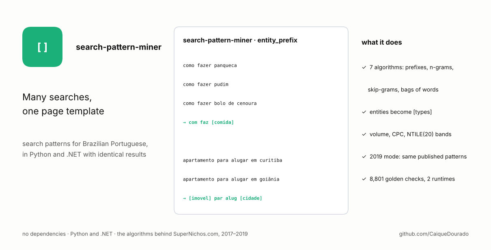

Turn search queries into reusable patterns, so that thousands of searches become one page template:

```text
como fazer panqueca          ┐
como fazer pudim             ├─ com faz [comida]
como fazer bolo de cenoura   ┘

apartamento para alugar em curitiba  ┐
apartamento para alugar em goiânia   ┴─ [imovel] par alug [cidade]
```

These are the seven algorithms the author wrote in C# from 2017 to 2019 to choose which of his ~80 programmatic SEO
sites to build, and that later powered [SuperNichos.com](https://supernichos.com). Each one has a technical name
and, as in the original code, a family name as a nickname. The library runs in **Python and .NET with identical
results**, checked by the same 8,801 values in [`testdata/golden.json`](testdata/golden.json), and has no
dependencies in either language.

| Algorithm | Nickname | What it keeps | `como fazer bolo de cenoura` |
|---|---|---|---|
| `prefix` | Viana | the first 2–5 words | `com faz` · `com faz bol` · `com faz bol cenour` |
| `contiguous` | Vilela | every run of 2+ words, not already a prefix | `faz bol` · `bol cenour` · `faz bol cenour` |
| `skipgram` | Oliveira | 2–4 words in order, with gaps | `com bol` · `faz cenour` · `com faz cenour` … |
| `bag` | Dourado | 2–4 different words, any order | `bol com` · `cenour faz` · `bol cenour com faz` … |
| `entity_prefix` | Barbosa | `prefix` after entities become types | `com faz [comida]` |
| `entity_contiguous` | Figueredo | `contiguous` after entities become types | `faz [comida]` |
| `entity_skipgram` | Rosa | `skipgram` after entities become types | `com [comida]` |

Words are cut to their stem (*previsão* → `previsa`, *como* → `com`) by a port of Lucene's Brazilian stemmer, the
one the original code used, so the patterns read oddly but group well. Each algorithm only keeps what the ones
before it did not already produce for the same search (the exclusion chain).

## Install

```bash
pip install "search-pattern-miner @ git+https://github.com/CaiqueDourado/search-pattern-miner#subdirectory=python"
```

```bash
dotnet add package SearchPatternMiner   # once published; meanwhile reference dotnet/src/SearchPatternMiner
```

## Use

```python
from search_pattern_miner import Gazetteer, Search, aggregate, mine

gaz = Gazetteer.load("data/gazetteer-pt.tsv")      # surface<TAB>types, e.g. "curitiba\tLocal > Cidade"
mine("hotéis baratos em salvador", gaz, ["barbosa", "rosa"])
# {'entity_prefix': ['[turismo] barat', '[turismo] barat [local]', '[turismo] barat [cidade]'],
#  'entity_skipgram': ['[turismo] [local]', '[turismo] [cidade]']}

searches = [Search("como fazer pudim", volume=8100, competition=0.2, cpc=0.5),
            Search("como fazer panqueca", volume=49500, competition=0.7, cpc=2.1)]
for p in aggregate(searches, gaz, ["barbosa"]):
    print(p.pattern, p.num_searches, p.volume_total, p.top_search, p.band_volume)
# com faz [comida] 2 57600 como fazer panqueca 1
```

```csharp
using SearchPatternMiner;

var gaz = Gazetteer.Load("data/gazetteer-pt.tsv");
var patterns = Miner.Mine("como fazer panqueca", gaz, new[] { "barbosa" });   // entity_prefix: com faz [comida]
var top = Aggregator.Aggregate(searches, gaz, new[] { "entity_prefix" });
```

```bash
search-pattern-miner show "detran pe" --gazetteer data/gazetteer-pt.tsv
search-pattern-miner mine examples/keywords.csv --gazetteer data/gazetteer-pt.tsv --out patterns.csv --pairs pairs.csv
```

`mine` reads a CSV with `keyword` and, optionally, `volume`, `competition` and `cpc` columns (names can be changed
with flags, and `--group market` ranks patterns within each market). It writes one row per pattern with the number
of searches, total volume, mean competition and CPC, the search with the most volume, three examples and four
**bands from 1 to 20** (NTILE(20), the "vigintiles" of the original curation screens: band 1 = most volume, most
searches, lowest competition, lowest CPC).

## What a pattern looks like

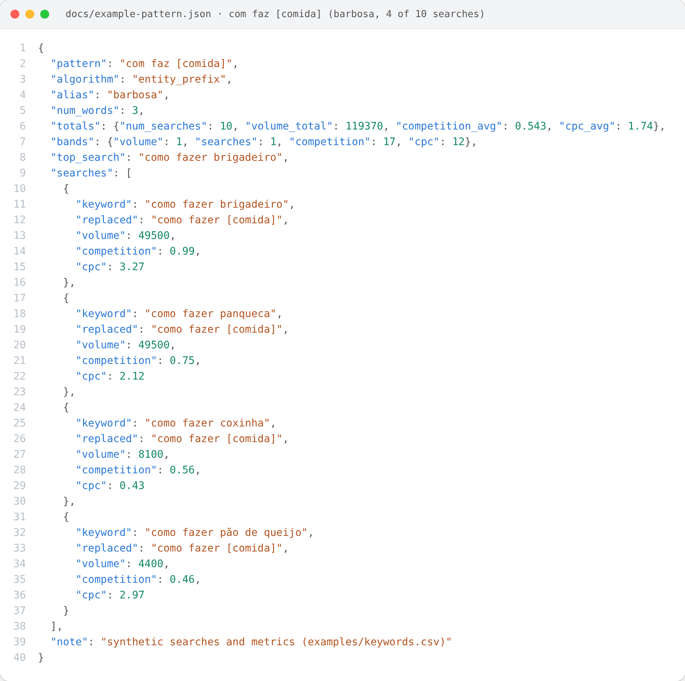

`com faz [comida]` groups the 10 "como fazer + food" searches of the synthetic example file: 119,370 searches a
month, first band of volume. Full file: [docs/example-pattern.json](docs/example-pattern.json), written by
[scripts/make_json.py](scripts/make_json.py).

## Entities

A gazetteer is a plain text file, one entity per line: the surface form, a tab, its types. `Local > Cidade` means the
entity is both a place and a city, and **one pattern is made per type** (the original never chose one). The library
ships a small example, [data/gazetteer-pt.tsv](data/gazetteer-pt.tsv): the 27 states and their codes, the 300+
municipalities with 100,000 people or more (from the author's [municipios-e-estados-do-brasil](https://github.com/CaiqueDourado/municipios-e-estados-do-brasil)),
and short hand-made lists of foods, lotteries, property types, tourism, documents, sites, public bodies, professions
and animals. For real work use [portuguese-entity-gazetteer](https://github.com/CaiqueDourado/portuguese-entity-gazetteer): 307 thousand entities with their types, in this
format (`gazetteer-pt.tsv` on [Kaggle](https://www.kaggle.com/datasets/caiquedourado/portuguese-entity-gazetteer)), the cleaned dictionary the original algorithms used.

## Two modes

| | `mode="fixed"` (default) | `mode="legacy2019"` |
|---|---|---|
| Entity matching | whole words, longest match at each position | string replacement, so `pr` (Paraná) matched inside *previsão* |
| Accents | folded for stopwords and entities; short words like `pará`/`para` and `pe`/`pé` must match exactly | stopwords matched with accents |
| Placeholders | one atomic token | protected by writing the type as `c¨i¨d¨a¨d¨e` during replacement |
| Repeated patterns | each pattern once | duplicates kept, as the original `List<string>` |
| Tokenizer | edge punctuation removed | digits and punctuation kept, a dropped word leaves a double space |

The legacy mode exists to reproduce the published data. On the rows of the
[google-keywords-dataset](https://github.com/CaiqueDourado/google-keywords-dataset) sample, it gives back every pattern
it was checked on ([evaluation/reproduce.py](evaluation/reproduce.py), [results](evaluation/results.md)):

| Published table | Rows checked | Reproduced |
|---|---:|---:|
| `padroes`, Brazilian prefixes (2018 batch) | 921 | 921 |
| `padroes_algoritmos`, Viana | 400 | 400 |
| `padroes_algoritmos`, Vilela (built before the exclusion chain) | 400 | 400 |

With the original 2019 entity dictionary (a 2022 snapshot, not published as is; its cleaned version is
[portuguese-entity-gazetteer](https://github.com/CaiqueDourado/portuguese-entity-gazetteer)), Barbosa and Rosa also reproduce 400 of 400 published rows and Figueredo 351
(the rest use type spellings of an older dictionary snapshot).

## How it works

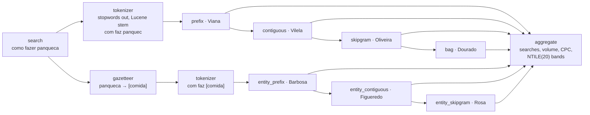

Every rule, with the bugs the legacy mode keeps on purpose, is in [spec/ALGORITHMS.md](spec/ALGORITHMS.md). In short:

- **Tokenizer.** Lower case, the NLTK Portuguese stopwords minus eight words that matter in searches (`para`,
  `mais`, `quando`, `como`, `muito`, `qual`, `pelo`, `pelos`), then the stem. Words of one or two letters disappear
  (Lucene's rule), so `sp` and `tv` never reach a pattern unless the gazetteer turns them into an entity first.
- **Exclusion chain**, per search: Vilela drops Viana's patterns, Oliveira drops both, Dourado drops all three;
  Figueredo drops Barbosa's, Rosa drops both. Pass `exclude=False` to get every pattern of every algorithm.
- **Expansion and collapse.** `[local>cidade]` becomes one pattern with `[local]` and one with `[cidade]`;
  `x [local] [local]` collapses to `x [local]`, but a pattern made only of the entity stays (`[local] [local]` was
  the second most common Barbosa pattern in the published data).

## Each algorithm, step by step

All seven start from the same tokenizer, then each one generates its patterns and drops what the ones before it
already produced for the same search (the exclusion chain). The examples are real outputs of the library with the
example gazetteer.

**Tokenizer** (shared)

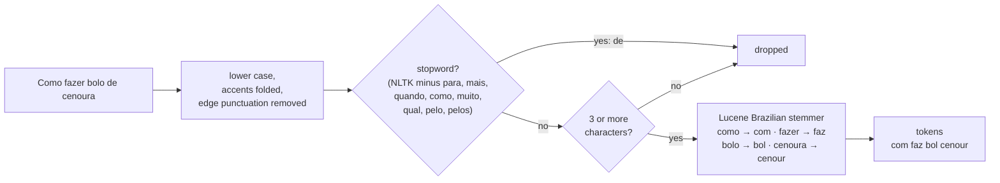

**Viana · `prefix`**: what a search *starts with*. Good for intents (`com faz …`, `previsa temp …`).

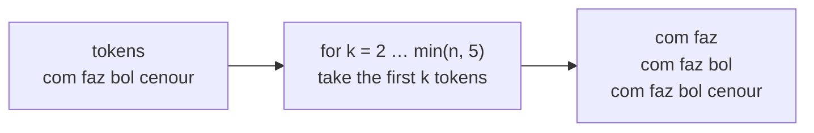

**Vilela · `contiguous`**: every run of words, wherever it is in the search. Finds the core of searches with
different openings.

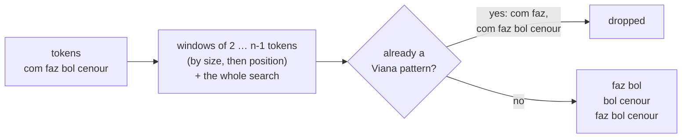

**Oliveira · `skipgram`**: 2 to 4 words in their order, with gaps. Joins searches that have extra words in the
middle (*como fazer **um** bolo de cenoura*).

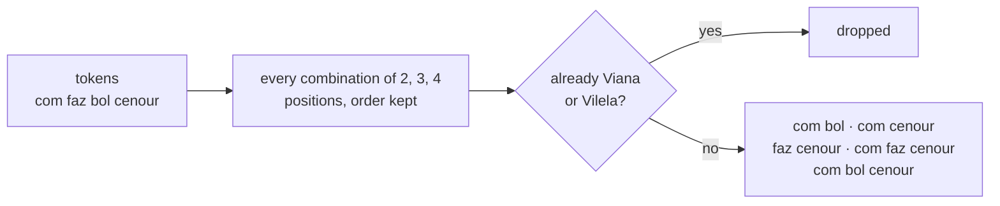

**Dourado · `bag`**: the same combinations with the order thrown away. Joins *bolo de cenoura como fazer* with
*como fazer bolo de cenoura*.

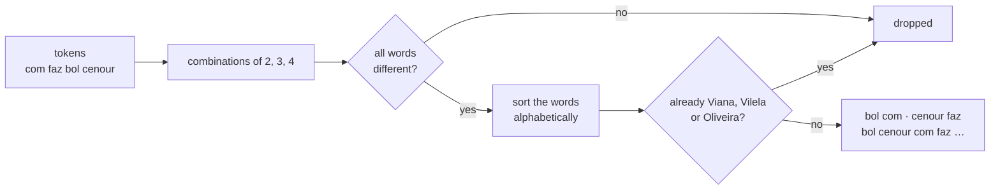

**Entity replacement** (shared by the next three)

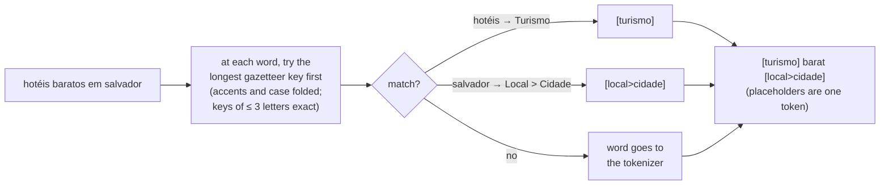

**Barbosa · `entity_prefix`**: Viana on the replaced search.

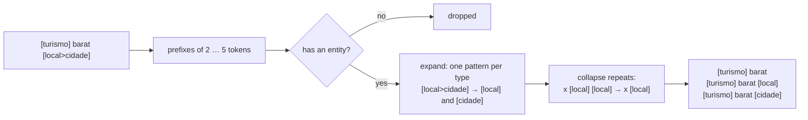

**Figueredo · `entity_contiguous`**: Vilela on the replaced search, without what Barbosa found.

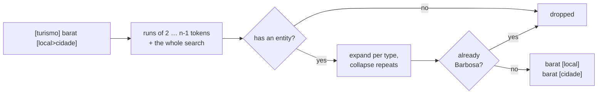

**Rosa · `entity_skipgram`**: Oliveira on the replaced search, without what Barbosa and Figueredo found. Written in
February 2019 for exactly this search: *hotéis baratos em salvador* → `[turismo] [local]`.

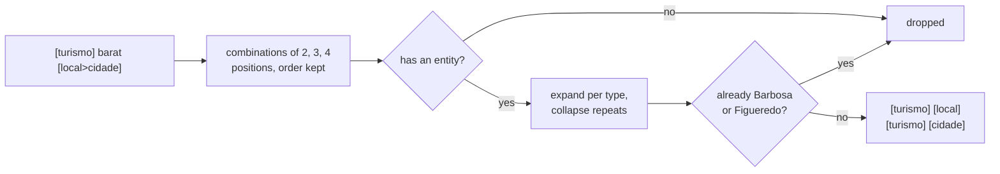

Then [`aggregate`](spec/ALGORITHMS.md#6-aggregation-aggregate) groups the patterns of every search: number of
searches, total volume, average competition and CPC, the leading search, and the 1–20 bands.

## The story

In 2018 the author had millions of Google searches with volume, CPC and competition, and needed to know which
sites to build. Reading searches one by one was hopeless, so he wrote algorithms that find what searches have in
common, first in T-SQL, then in C#: Dourado (bags of words) first, Vilela in October 2018, Viana and Barbosa in
January 2019, Rosa in February 2019 (written for *hotéis baratos em salvador* → `[turismo] [local]`). He then labelled
154 thousand patterns by hand with how they could make money. The output is published as the
[google-keywords-dataset](https://github.com/CaiqueDourado/google-keywords-dataset)
([Kaggle](https://www.kaggle.com/datasets/caiquedourado/google-keywords-dataset)): 37.96 million searches and
1.73 million patterns of five of these algorithms. This library is that code, rewritten from scratch, tested, with
the bugs fixed by default and kept on request.

## Limits

- Brazilian Portuguese only. The non-Brazilian markets of the dataset were stemmed with Snowball English and
  Spanish; that step is not included (tokenize the text yourself and call the generators).
- The generalized parent pattern (`padrao_pai`) of the published table is not implemented: its original rule was
  not found.
- The stemmer is aggressive on purpose (`hotéis` → `hot`), as in the original; it groups well but reads badly.
  Show `top_search` to people, not the pattern.
- Skip-grams and bags of words grow fast with long searches (up to 4 words out of n); searches over 150 characters
  produce nothing, as in the original.

## Related

- [portuguese-entity-gazetteer](https://github.com/CaiqueDourado/portuguese-entity-gazetteer): 307 thousand Portuguese entities with their types, ready to load as a gazetteer ([Kaggle](https://www.kaggle.com/datasets/caiquedourado/portuguese-entity-gazetteer)).
- [google-keywords-dataset](https://github.com/CaiqueDourado/google-keywords-dataset): 38 million searches and the 1.73 million patterns these algorithms produced ([Kaggle](https://www.kaggle.com/datasets/caiquedourado/google-keywords-dataset)).
- [DedupKit](https://github.com/CaiqueDourado/DedupKit): the same family of keys (folding, stems, phonetic keys) applied to product names.
- [dicionario-portugues](https://github.com/CaiqueDourado/dicionario-portugues): 272 thousand Portuguese words with stems and phonetic keys.
- [municipios-e-estados-do-brasil](https://github.com/CaiqueDourado/municipios-e-estados-do-brasil): the places in the example gazetteer.

## Repository

```text
python/        package search-pattern-miner (src/, tests/)
dotnet/        SearchPatternMiner, its tests and a sample (MinePatterns)
spec/          ALGORITHMS.md: every rule, the contract both languages follow
testdata/      golden.json, the values both test suites check
data/          gazetteer-pt.tsv, the example gazetteer
examples/      keywords.csv, synthetic searches with invented metrics
evaluation/    reproduction of the published patterns
tools/         make_testdata.py, make_gazetteer.py, make_examples.py
docs/ scripts/ cover and JSON image
```

License: [MIT](LICENSE). The stemmer is a port of Lucene's BrazilianStemmer (Apache 2.0); see
[THIRD-PARTY-NOTICES.md](THIRD-PARTY-NOTICES.md).
