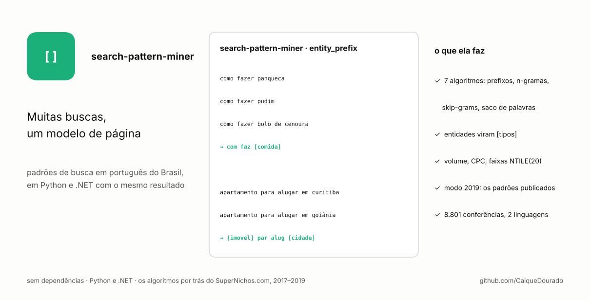
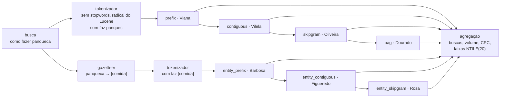

# search-pattern-miner

[English](README.md)

[](https://github.com/CaiqueDourado/search-pattern-miner/actions/workflows/python.yml)
[](https://github.com/CaiqueDourado/search-pattern-miner/actions/workflows/dotnet.yml)




Transforma buscas em padrões reaproveitáveis, para que milhares de buscas virem um modelo de página:

```text
como fazer panqueca          ┐
como fazer pudim             ├─ com faz [comida]
como fazer bolo de cenoura   ┘

apartamento para alugar em curitiba  ┐
apartamento para alugar em goiânia   ┴─ [imovel] par alug [cidade]
```

São os sete algoritmos que o autor escreveu em C# entre 2017 e 2019 para escolher quais dos seus ~80 sites de SEO
programático construir, e que depois sustentaram o [SuperNichos.com](https://supernichos.com). Cada um tem um nome
técnico e, como no código original, um sobrenome como apelido. A biblioteca roda em **Python e .NET com o mesmo
resultado**, conferido pelos mesmos 8.801 valores de [`testdata/golden.json`](testdata/golden.json), e não tem
dependências em nenhuma das duas.

| Algoritmo | Apelido | O que guarda | `como fazer bolo de cenoura` |
|---|---|---|---|
| `prefix` | Viana | as primeiras 2 a 5 palavras | `com faz` · `com faz bol` · `com faz bol cenour` |
| `contiguous` | Vilela | toda sequência de 2+ palavras que não seja prefixo | `faz bol` · `bol cenour` · `faz bol cenour` |
| `skipgram` | Oliveira | 2 a 4 palavras na ordem, com saltos | `com bol` · `faz cenour` · `com faz cenour` … |
| `bag` | Dourado | 2 a 4 palavras diferentes, em qualquer ordem | `bol com` · `cenour faz` · `bol cenour com faz` … |
| `entity_prefix` | Barbosa | `prefix` depois de as entidades virarem tipos | `com faz [comida]` |
| `entity_contiguous` | Figueredo | `contiguous` depois de as entidades virarem tipos | `faz [comida]` |
| `entity_skipgram` | Rosa | `skipgram` depois de as entidades virarem tipos | `com [comida]` |

As palavras são reduzidas ao radical (*previsão* → `previsa`, *como* → `com`) por uma porta do stemmer brasileiro do
Lucene, o mesmo que o código original usava; por isso os padrões soam estranhos, mas agrupam bem. Cada algoritmo só
guarda o que os anteriores ainda não produziram para a mesma busca (a cadeia de exclusão).

## Instalação

```bash
pip install "search-pattern-miner @ git+https://github.com/CaiqueDourado/search-pattern-miner#subdirectory=python"
```

```bash
dotnet add package SearchPatternMiner   # quando publicado; por enquanto, referencie dotnet/src/SearchPatternMiner
```

## Uso

```python
from search_pattern_miner import Gazetteer, Search, aggregate, mine

gaz = Gazetteer.load("data/gazetteer-pt.tsv")      # forma<TAB>tipos, ex.: "curitiba\tLocal > Cidade"
mine("hotéis baratos em salvador", gaz, ["barbosa", "rosa"])
# {'entity_prefix': ['[turismo] barat', '[turismo] barat [local]', '[turismo] barat [cidade]'],
#  'entity_skipgram': ['[turismo] [local]', '[turismo] [cidade]']}

searches = [Search("como fazer pudim", volume=8100, competition=0.2, cpc=0.5),
            Search("como fazer panqueca", volume=49500, competition=0.7, cpc=2.1)]
for p in aggregate(searches, gaz, ["barbosa"]):
    print(p.pattern, p.num_searches, p.volume_total, p.top_search, p.band_volume)
# com faz [comida] 2 57600 como fazer panqueca 1
```

```csharp
using SearchPatternMiner;

var gaz = Gazetteer.Load("data/gazetteer-pt.tsv");
var patterns = Miner.Mine("como fazer panqueca", gaz, new[] { "barbosa" });   // entity_prefix: com faz [comida]
var top = Aggregator.Aggregate(searches, gaz, new[] { "entity_prefix" });
```

```bash
search-pattern-miner show "detran pe" --gazetteer data/gazetteer-pt.tsv
search-pattern-miner mine examples/keywords.csv --gazetteer data/gazetteer-pt.tsv --out patterns.csv --pairs pairs.csv
```

O `mine` lê um CSV com a coluna `keyword` e, se houver, `volume`, `competition` e `cpc` (os nomes mudam por opção, e
`--group market` ordena os padrões dentro de cada mercado). Ele grava uma linha por padrão com o número de buscas,
o volume total, as médias de concorrência e CPC, a busca de maior volume, três exemplos e quatro **faixas de 1 a 20**
(NTILE(20), os "vigintis" das telas de curadoria originais: faixa 1 = mais volume, mais buscas, menos concorrência,
CPC mais baixo).

## Como um padrão é estruturado


`com faz [comida]` junta as 10 buscas "como fazer + comida" do arquivo de exemplo sintético: 119.370 buscas por mês,
primeira faixa de volume. Arquivo completo: [docs/example-pattern.json](docs/example-pattern.json), gerado por
[scripts/make_json.py](scripts/make_json.py).

## Entidades

O dicionário de entidades (gazetteer) é um arquivo de texto, uma entidade por linha: a forma escrita, um tab e os
tipos. `Local > Cidade` quer dizer que a entidade é um lugar e uma cidade, e **cada tipo gera um padrão** (o original
nunca escolhia um). A biblioteca traz um exemplo pequeno, [data/gazetteer-pt.tsv](data/gazetteer-pt.tsv): os 27
estados e suas siglas, os 300+ municípios com 100 mil habitantes ou mais (da base do autor
[municipios-e-estados-do-brasil](https://github.com/CaiqueDourado/municipios-e-estados-do-brasil)) e listas curtas,
feitas à mão, de comidas, loterias, tipos de imóvel, turismo, documentos, sites, órgãos, profissões e animais. Para
uso real, traga o seu: Wikidata e DBpedia são boas fontes (atenção às licenças).

## Dois modos

| | `mode="fixed"` (padrão) | `mode="legacy2019"` |
|---|---|---|
| Casamento de entidades | palavras inteiras, a mais longa em cada posição | troca de texto, por isso `pr` (Paraná) casava dentro de *previsão* |
| Acentos | ignorados em stopwords e entidades; palavras curtas como `pará`/`para` e `pe`/`pé` precisam casar exatamente | stopwords comparadas com acento |
| Marcadores | um token único | protegidos escrevendo o tipo como `c¨i¨d¨a¨d¨e` durante a troca |
| Padrões repetidos | cada padrão uma vez | duplicatas mantidas, como na `List<string>` original |
| Tokenizador | pontuação das pontas removida | dígitos e pontuação mantidos; palavra descartada deixa espaço duplo |

O modo legado existe para reproduzir os dados publicados. Nas linhas da amostra do
[google-keywords-dataset](https://github.com/CaiqueDourado/google-keywords-dataset), ele devolve todos os padrões
conferidos ([evaluation/reproduce.py](evaluation/reproduce.py), [resultados](evaluation/results.md)):

| Tabela publicada | Linhas conferidas | Reproduzidas |
|---|---:|---:|
| `padroes`, prefixos do Brasil (lote de 2018) | 921 | 921 |
| `padroes_algoritmos`, Viana | 400 | 400 |
| `padroes_algoritmos`, Vilela (feita antes da cadeia de exclusão) | 400 | 400 |

Com o dicionário de entidades original de 2019, que não é publicado porque tem títulos de anúncio e marcas que
pediram remoção, Barbosa e Rosa também reproduzem 400 de 400 linhas publicadas, e Figueredo 351 (as demais usam a
grafia de tipos de uma versão mais antiga do dicionário).

## Como funciona



Todas as regras, inclusive os bugs que o modo legado mantém de propósito, estão em
[spec/ALGORITHMS.md](spec/ALGORITHMS.md). Em resumo:

- **Tokenizador.** Minúsculas, as stopwords do NLTK em português menos oito palavras que importam em buscas (`para`,
  `mais`, `quando`, `como`, `muito`, `qual`, `pelo`, `pelos`), depois o radical. Palavras de uma ou duas letras somem
  (regra do Lucene), então `sp` e `tv` só chegam a um padrão se o gazetteer as transformar em entidade antes.
- **Cadeia de exclusão**, por busca: Vilela descarta os padrões da Viana, Oliveira descarta os dois, Dourado
  descarta os três; Figueredo descarta os do Barbosa, Rosa descarta os dois. Use `exclude=False` para ter todos os
  padrões de todos os algoritmos.
- **Expansão e colapso.** `[local>cidade]` vira um padrão com `[local]` e outro com `[cidade]`; `x [local] [local]`
  vira `x [local]`, mas um padrão feito só da entidade fica (`[local] [local]` era o segundo padrão Barbosa mais
  comum nos dados publicados).

## A história

Em 2018 o autor tinha milhões de buscas do Google com volume, CPC e concorrência e precisava saber que sites
construir. Ler busca por busca era inviável, então ele escreveu algoritmos que acham o que as buscas têm em comum,
primeiro em T-SQL, depois em C#: Dourado (saco de palavras) primeiro, Vilela em outubro de 2018, Viana e Barbosa em
janeiro de 2019, Rosa em fevereiro de 2019 (escrito para *hotéis baratos em salvador* → `[turismo] [local]`). Depois
ele rotulou à mão 154 mil padrões com o jeito de ganhar dinheiro com cada um. O resultado está publicado no
[google-keywords-dataset](https://github.com/CaiqueDourado/google-keywords-dataset)
([Kaggle](https://www.kaggle.com/datasets/caiquedourado/google-keywords-dataset)): 37,96 milhões de buscas e
1,73 milhão de padrões de cinco desses algoritmos. Esta biblioteca é aquele código, reescrito do zero, testado, com
os bugs corrigidos por padrão e mantidos quando pedido.

## Limites

- Só português do Brasil. Os mercados de fora do Brasil do dataset usaram o Snowball de inglês e espanhol; esse
  passo não está incluído (tokenize o texto por conta própria e chame os geradores).
- O padrão pai generalizado (`padrao_pai`) da tabela publicada não foi implementado: a regra original não foi
  encontrada.
- O stemmer é agressivo de propósito (`hotéis` → `hot`), como no original; agrupa bem, mas lê mal. Mostre o
  `top_search` para pessoas, não o padrão.
- Skip-grams e sacos de palavras crescem rápido em buscas longas (até 4 palavras de n); buscas com mais de 150
  caracteres não geram nada, como no original.

## Relacionados

- [google-keywords-dataset](https://github.com/CaiqueDourado/google-keywords-dataset): 38 milhões de buscas e os 1,73 milhão de padrões que estes algoritmos produziram ([Kaggle](https://www.kaggle.com/datasets/caiquedourado/google-keywords-dataset)).
- [DedupKit](https://github.com/CaiqueDourado/DedupKit): a mesma família de chaves (acentos, radicais, chave fonética) aplicada a nomes de produto.
- [dicionario-portugues](https://github.com/CaiqueDourado/dicionario-portugues): 272 mil palavras do português com radicais e chaves fonéticas.
- [municipios-e-estados-do-brasil](https://github.com/CaiqueDourado/municipios-e-estados-do-brasil): os lugares do gazetteer de exemplo.

## Repositório

```text
python/        pacote search-pattern-miner (src/, tests/)
dotnet/        SearchPatternMiner, os testes e um exemplo (MinePatterns)
spec/          ALGORITHMS.md: todas as regras, o contrato que as duas linguagens seguem
testdata/      golden.json, os valores que os dois conjuntos de testes conferem
data/          gazetteer-pt.tsv, o gazetteer de exemplo
examples/      keywords.csv, buscas sintéticas com métricas inventadas
evaluation/    reprodução dos padrões publicados
tools/         make_testdata.py, make_gazetteer.py, make_examples.py
docs/ scripts/ capa e imagem do JSON
```

Licença: [MIT](LICENSE). O stemmer é uma porta do BrazilianStemmer do Lucene (Apache 2.0); veja
[THIRD-PARTY-NOTICES.md](THIRD-PARTY-NOTICES.md).
